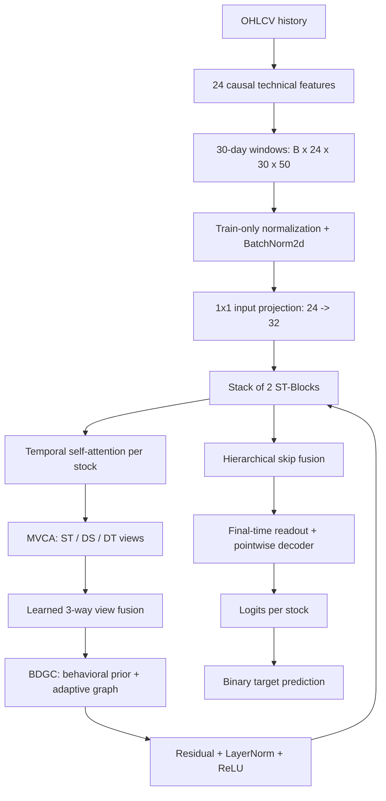

# ST-GRAD Reproduction Blueprint

**Purpose:** An implementation-ready specification for an autonomous coding agent to reproduce *ST-GRAD: Multi-view cross-attention and bidirectional diffusion for stock trend prediction* by Yu Fu, Zhengming Huang, and Bin Yu, *Expert Systems With Applications* 330 (2026), article 133046, DOI: [10.1016/j.eswa.2026.133046](https://doi.org/10.1016/j.eswa.2026.133046).

**Primary source:** the supplied 21-page paper. Page numbers in this document refer to the printed PDF page numbers. The paper's figures and tables are part of the specification: Fig. 1 (p. 4) gives the overall model; Fig. 2 (p. 6) explains MVCA; Table 4 (p. 11) lists the stock universe; Table 5 (p. 12) defines features; Tables 7-12 (pp. 13-19) give configurations and expected results.

**Source-code archive inspected:** the supplied `ST-GRAD-Stock-Prediction-6E7D.zip` corresponds to the paper-linked [anonymous repository](https://anonymous.4open.science/r/ST-GRAD-Stock-Prediction-6E7D). The archive contains no `.git` metadata, so a source commit cannot be pinned from this ZIP; its SHA-256 is `690ed2f727a588bb71b6f74c863396a2a2dd129d0c99de8441ec04889a012434`. The source is runnable at a basic level but has material discrepancies with the paper. See **Section 16** and the companion `ST_GRAD_REPOSITORY_AUDIT.md` before using its outputs as evidence of faithful reproduction.

---

## 1. Instructions to the implementation agent

Build a reproducible research repository, not just a model class. The final repository must download or load immutable raw data, construct features and labels without look-ahead leakage, build the behavioral prior graph, train ST-GRAD, run ablations and baselines, evaluate it, and write machine-readable metrics and plots.

### Order of work

1. **Run and audit the supplied repository before changing it.** The ZIP has been inspected and smoke-tested, but contains no `.git` metadata. Record its archive hash, run the included preprocessing, load both checkpoints, and retain a `repo_compat` configuration that captures its behavior. Then build a separate `paper_aligned` implementation guided by this document. Record every difference in `docs/reproduction_deviations.md`; never silently overwrite the source-compatible path or call the two variants equivalent.
2. Implement the raw-data and feature pipeline, unit tests, and a deterministic baseline data dump before the neural architecture.
3. Implement ST-GRAD modules individually with shape assertions and unit tests. Add a small random-tensor forward/backward smoke test before training on stock data.
4. Train ST-GRAD with the published configuration and save full logs and checkpoints for five seeds.
5. Reproduce the graph comparison, ablations, hyperparameter sensitivity, orthogonality diagnostics, baseline comparison, and stress-window evaluation in separate scripts.
6. Compare outputs with the paper's tables. Report both matches and deviations; do not tune the test set just to hit reported values.

### Non-negotiable requirements

- Do not treat the anonymous implementation as a fully faithful paper implementation. It gives a useful runnable baseline and reference checkpoints, but several core operations diverge from the paper. Maintain separate, explicitly named `repo_compat` and `paper_aligned` configurations/results.
- Use chronological splits. Never shuffle time points before constructing train/validation/test partitions.
- Fit feature normalizers, graph clustering inputs, and any target-dependent auxiliary encoder only using permitted historical/training data.
- All features for a sample ending on date `t` must use observations at or before `t`. Its label may use `t+1` only.
- Set all seeds, log them, preserve the exact split and feature files, and write environment versions to each run directory.
- Keep every ambiguous choice in a config file and report it in run metadata.
- Do not claim financial profitability. The paper evaluates binary trend classification, not a trading strategy net of fees, slippage, and execution assumptions.

## 2. Paper claims and reproduction targets

ST-GRAD addresses two stated gaps in spatio-temporal graph neural networks for stocks:

1. Existing methods often model a single relational view. **Multi-View Cross-Attention (MVCA)** separates feature relationships into three views: spatio-temporal (ST), feature-spatio (DS), and feature-temporal (DT).
2. Static graphs are rigid and fully adaptive graphs may be noisy. **Bidirectional Diffusion Graph Convolution (BDGC)** combines a static prior built from deep behavioral clustering and a learned adaptive adjacency matrix.

Stacked ST-Blocks process the transformed stock tensor. The outputs across the stack are combined by a hierarchical/skip fusion and decoded into one binary trend prediction per stock.

**Published core configuration (Table 7, p. 13):**

| Setting | Published value |
|---|---:|
| Number of stocks/nodes, `N` | 50 |
| Engineered features, `F` | 24 |
| Input window, `T` | 30 trading days |
| Hidden channels, `D` | 32 |
| ST-Blocks, `L` | 2 |
| Adaptive node embedding dimension, `d` | 10 |
| Diffusion steps, `K_diff` | 2 |
| Temporal-attention heads | 4 |
| Batch size | 32 date-windows |
| Optimizer | AdamW |
| Learning rate | 0.001 |
| Weight decay | 0.01 |
| Epochs | 50 |
| Runs | 5 |
| Best-checkpoint criterion | Validation F1 |
| Framework in paper | PyTorch 2.4.1, CUDA 12.1 |
| Hardware in paper | NVIDIA GeForce RTX 4060 Laptop, 8 GB VRAM |
| Reported parameter count | 216,429 |
| Reported training time | 51.64 s/run (hardware- and implementation-dependent) |

**Published headline metrics (Table 8, p. 15; means and standard deviations across five runs):**

| Model | Accuracy | Precision | Recall | F1 | AUC |
|---|---:|---:|---:|---:|---:|
| ST-GRAD | 0.8313 ± 0.0018 | 0.7705 ± 0.0063 | 0.8799 ± 0.0078 | 0.8215 ± 0.0009 | 0.9046 ± 0.0003 |
| CNN-LSTM | 0.8309 ± 0.0027 | 0.8019 ± 0.0031 | 0.8194 ± 0.1147 | 0.8105 ± 0.0045 | 0.9040 ± 0.0012 |
| AASTHGCN | 0.8277 ± 0.0031 | 0.7852 ± 0.0100 | 0.8115 ± 0.0136 | 0.7964 ± 0.0036 | 0.9017 ± 0.0031 |
| COGRASP | 0.7859 ± 0.0013 | 0.7468 ± 0.0083 | 0.7794 ± 0.0151 | 0.7626 ± 0.0029 | 0.8619 ± 0.0007 |

These are comparison targets, not pass/fail guarantees. Yahoo data may change; several preprocessing choices are unspecified; and the paper's stress-window protocol has ambiguities (see Section 10).

## 3. Data required

### 3.1 Raw data source and dates

The paper says it uses Yahoo Finance daily observations from **2020-08-19 to 2025-08-18**, with five OHLCV indicators (`Open`, `High`, `Low`, `Close`, `Volume`) and 1,255 data points per stock. The downloader must request the inclusive dates correctly. In `yfinance`, `end` is exclusive, so a request intended to include 2025-08-18 generally uses `end="2025-08-19"`. Pin the downloader version, preserve all original responses, and record the exact request parameters.

**Do not silently alter or drop any ticker.** The symbols below are transcribed from Table 4 (p. 11). Validate symbols and download availability; if Yahoo has renamed, delisted, or no longer serves one, log it and seek the author archive before substituting another asset.

| Sector in paper | Tickers |
|---|---|
| Energy | `CTRA`, `DKL`, `KNTK`, `MTDR`, `MUR`, `NEXT`, `NOG`, `NOV`, `PAGP`, `USAC` |
| Healthcare | `BIIB`, `CNC`, `GMAB`, `ICLR`, `INCY`, `SAUHY`, `SNN`, `TEVA`, `WAT`, `ZBH` |
| Technology | `AMKR`, `ARW`, `CAJPY`, `HPE`, `JKHY`, `LFUS`, `NTAP`, `PTC`, `STM`, `VRSN` |
| Basic Materials | `AXTA`, `IVPAF`, `LYSCF`, `LYSDY`, `MP`, `RGLD`, `SOUHY`, `SSD`, `SUZ`, `WFG` |
| Industrials | `ABM`, `ALG`, `HRI`, `HUBG`, `ODFL`, `SBLK`, `TEX`, `TNET`, `TRN`, `VWDRY` |

### 3.2 Raw data schema and data audit

Store one row per `(date, ticker)` with, at minimum:

- `date`, `ticker`, `sector`
- `open`, `high`, `low`, `close`, `volume`
- `adj_close` and corporate-action fields if provided by the downloader (do not use them unless the chosen adjustment policy says so)
- `is_missing_original`, `was_forward_filled`, `is_valid_for_loss`

Write `data/raw/<ticker>.csv` and an aggregated `data/processed/ohlcv.parquet`. The raw files must be immutable after acquisition. Store hashes, downloader version, UTC fetch time, query settings, and row counts in `data/manifest.json`.

Audit each ticker for: missing dates, duplicate dates, non-positive prices, negative volume, split/dividend anomalies, infinities, sudden price discontinuities, number of rows, first/last observation, and whether the exact target period exists. Produce `reports/data_audit.csv` and fail fast if a ticker has no usable history.

**Adjustment ambiguity:** the paper does not clearly say whether OHLC values were split/dividend-adjusted. First inspect the author's code/data. Otherwise, make this a configuration option and run a sensitivity comparison for adjusted vs. unadjusted OHLC. State the selected policy. Never mix adjusted and unadjusted OHLC columns in a single feature set. The feature calculations below use the paper's `Close` symbol; the exact Yahoo field policy must be explicit.

### 3.3 Cross-stock calendar alignment

The model uses `X ∈ R^(B×F×T×N)` and a fixed graph with 50 nodes. Create one deterministic master date index. Prefer the common US trading calendar if every data series actually follows it; otherwise use the union of date indices and record each ticker's market-calendar mismatch. Reindex stocks to that master index without using future data. The paper says to forward-fill missing prices, but does not specify the alignment calendar or how to treat missing volume.

Recommended fallback policy if no author code is available:

- Forward-fill missing price observations only within a ticker after its first valid observation; never backfill from the future.
- Do not forward-fill volume as if it were traded volume. Represent unavailable volume separately and invalidate samples whose engineered features cannot be trusted.
- Convert `NaN`/`+inf`/`-inf` produced by formulas to finite values only according to a logged rule. The paper says infinities are set to zero and broadly invalid samples are masked.
- Build a node-level validity mask; use it to exclude invalid targets/features from loss and metrics instead of treating missing observations as genuine zero-return events.
- Report counts of ffilled values and masked node-days per ticker.

### 3.4 Number of samples and windows

The paper claims 1,255 raw points/stock; after a 30-day warm-up and one-day target horizon, it reports **1,224 sequential samples**. Each sample is a 30-day historical window across all 50 stocks and has a target vector of size 50. So the expected tensor shapes are:

- one feature panel: `[date, ticker, 24]`
- one input window: `[24, 30, 50]` (`F,T,N`)
- one batched input: `[B, 24, 30, 50]`
- one target batch: `[B, 50]`

Assign each sample to a split according to its **target date**, not just the last input date. Unit-test that no window's feature dates exceed the input-end date and its label date is exactly the next trading date under the chosen calendar.

## 4. Feature engineering (Table 5, p. 12)

The paper states that raw absolute prices must not be fed directly to the network. It engineers 24 normalized/technical features from OHLCV. Implement the 24 columns in a named registry with fixed order, dtype `float32`, and unit tests against hand-calculated toy series. Use trailing/causal rolling windows only.

Let `O_t`, `H_t`, `L_t`, `C_t`, and `V_t` denote open, high, low, close, and volume. `MA_k(x)` is a trailing k-day simple moving average; `EMA_k` is an exponential moving average; `sigma_k` is a trailing k-day standard deviation; `r_t = C_t/C_(t-1) - 1`; and `TP_t=(H_t+L_t+C_t)/3`.

| Index | Paper feature | Formula/definition from Table 5 | Implementation notes |
|---:|---|---|---|
| 1 | `f_rel_c` | `C_t / MA30(C)` | Relative close to 30-day average |
| 2 | `f_ocr` | `(C_t - O_t) / O_t` | Intraday close/open return |
| 3 | `f_vwap` | Trailing 30-day volume-weighted price, `sum(V*price)/sum(V)` | Table defines `TP_t`; inspect the author code to resolve whether numerator uses `TP` or `Close` |
| 4 | `f_c_ma` | `C_t / MA20(C)` | Relative close to 20-day average |
| 5 | `f_roc` | `C_t / C_(t-12) - 1` | 12-day rate of change |
| 6 | `f_mom_5` | `C_t / C_(t-5) - 1` | Momentum, k=5 |
| 7 | `f_mom_10` | `C_t / C_(t-10) - 1` | Momentum, k=10 |
| 8 | `f_p_acc` | `r_t - r_(t-1)` | One-step price-return acceleration |
| 9 | `f_ma_diff` | `(MA5(C)-MA20(C))/MA20(C)` | Relative short-vs-long moving-average gap |
| 10 | `f_rsi` | `100 - 100/(1+RS_(t,21))` | RS is ratio of k-day average gains to losses; use k=21 |
| 11 | `f_rsi_rel` | `f_rsi/50 - 1` | RSI centered/scaled around 50 |
| 12 | `f_macd` | `(MACD_t - EMA9(MACD)_t)/C_t`, `MACD=EMA12(C)-EMA26(C)` | This is the formula shown in the paper, not simply the conventional raw MACD line |
| 13 | `f_v_rat` | `V_t / MA30(V)` | Relative volume |
| 14 | `f_v_pct` | `V_t / V_(t-1) - 1` | Daily volume percentage change |
| 15 | `f_v_mom` | `V_t / V_(t-5) - 1` | Five-day volume momentum |
| 16 | `f_pv_corr` | `Corr10(r, f_v_pct)` | 10-day rolling Pearson correlation of return and volume change |
| 17 | `f_volat` | `sigma5(C) / MA5(C)` | Normalized five-day close volatility |
| 18 | `f_bb_w` | `4*sigma20(C) / MA20(C)` | Relative Bollinger width as printed |
| 19 | `f_bb_p` | `(C_t - BB_low_t)/(4*sigma20(C))`, `BB_low=MA20(C)-2*sigma20(C)` | Keep exact displayed scaling; it differs from some common Bollinger %B conventions |
| 20 | `f_atr` | `MA14(TR)`, `TR=max(H-L, abs(H-C_(t-1)), abs(L-C_(t-1)))` | Paper defines 14-day moving average true range; it does not explicitly normalize ATR by price |
| 21 | `f_hl_rat` | `H_t / L_t` | High/low ratio |
| 22 | `f_volat_rat` | `sigma5(C)/sigma20(C)` | Short-/long-window volatility ratio |
| 23 | `f_cvh` | `(C_t-L_t)/(H_t-L_t)` | Close position in daily range; guard zero denominator |
| 24 | `f_srs` | `f_mom_5 - MA10(f_mom_5)` | Sector-relative-strength proxy as defined by the paper; no cross-stock sector aggregation is shown in the formula |

Feature computation requirements:

- Use `min_periods=window_size` for rolling features unless the author code demonstrates otherwise. Warm-up rows are invalid rather than silently filled with rolling partial windows.
- Define RSI gain/loss smoothing precisely (simple mean vs. Wilder's recursive smoothing is not stated); inspect code first. If unavailable, choose Wilder's standard RSI and document it.
- Define standard deviation convention (`ddof=0` or `1`) and EMA initialization explicitly.
- Guard denominators with a small epsilon, but preserve an invalid/mask flag when the denominator is genuinely zero. Do not let an epsilon convert missing/invalid data into a meaningful signal without logging it.
- Verify exactly 24 features, order, no infinite values after sanitization, and no current/future data beyond the sample's input-end date.
- The paper calls these “strictly stationary.” Normalization by moving averages does not by itself prove stationarity. Describe them as the paper's scale-normalized/technical features unless statistical tests are independently conducted.

**Verified source discrepancy:** `utils/data_processor.py` implements the VWAP-like feature as `(rolling_sum(TP) + volume * close) / (rolling_sum(volume) + volume)`. This does not match a conventional volume-weighted sum and does not cleanly match the displayed Table 5 expression. Table 5 itself appears to add the current-day term to a sum whose index includes the current day, so the printed formula may double-count the current observation. Preserve the literal source behavior in `repo_compat`; in `paper_aligned`, implement the equation actually supported by the paper and state the interpretation in the deviation log.

## 5. Target generation and split protocol

### 5.1 Binary target from Equations (28)-(30), pp. 12-13

The task is binary classification. For stock `i` and input-end date `t`:

**Verified source discrepancy:** `utils/data_processor.py:create_labels()` currently indexes `data[..., 0]`, where feature index 0 is `Relative_Close`, not raw `Close`. Its computed return therefore compares a relative-close ratio against the average of relative-close ratios rather than computing `(future_close - mean_past_close) / mean_past_close` as in Eq. (29). It also uses `tanh(abs(volume_pct) * 8)` when Eq. (28) shows `tanh(abs(volume_pct))`. Finally, low-volume-change/invalid nodes are initialized to label 0; no per-node target-validity mask is saved. These are target-definition changes, not harmless implementation details. Use raw close for labels in `paper_aligned`, serialize a validity mask, and keep the source behavior only in `repo_compat`.

1. `Pbar_(i,t)` is the average close over a recent lookback window. The text defines it as an average over the past `t` days but does **not** clearly specify the number of days in this target formula. `MA30(C)` is a reasonable fallback consistent with the 30-day warm-up; label this as an assumption unless the author implementation resolves it.
2. Volume change is described as a percentage change, consistent with `f_v_pct = V_t/V_(t-1)-1`.
3. Volatility-adaptive threshold:
   `T_(i,t) = T_base * (1 + k * tanh(abs(volume_change_(i,t))))`, with `T_base=0.0003` and `k=3`.
4. Benchmark-relative next-day return:
   `R_(i,t+1) = (C_(i,t+1) - Pbar_(i,t)) / Pbar_(i,t)`.
5. Positive class:
   `y_(i,t)=1` if `R_(i,t+1) > T_(i,t)` and the positive survives the paper's 10% stochastic dropout; otherwise `y_(i,t)=0`.

This is **not** the usual sign of close-to-close return label: only sufficiently large upward movement is positive; all other cases are negative. The paper also says it excludes highly inactive samples using a minimum absolute volume change of 0.3%, but it does not make completely clear whether this drops a sample, masks a stock label, or is just a screening step. Make both the threshold and filter explicit in config, and report the number of excluded node-days.

**Stochastic target warning:** a 10% positive-label dropout is target corruption, not conventional label smoothing. The paper does not say which split(s) receive it or how its random mask is seeded. If the author's source resolves this, follow it. Otherwise implement two named modes:

- `paper_literal`: construct a single fixed, seeded label mask once and apply the 10% positive dropout as the paper's equation states; cache labels so different model seeds do not silently change evaluation targets.
- `clean_eval`: only apply any 10% corruption to training positives; never randomize validation/test targets.

Use `paper_literal` for the closest formula-level replication and report `clean_eval` as a methodological robustness check. Do not conflate their scores.

### 5.2 Published split description and ambiguity

The paper reports 1,224 samples, partitioned chronologically as follows:

- Training: 856 samples (70%), stated sample dates 2020-09-30 through 2024-02-26.
- Out-of-sample remainder: 368 samples (30%), stated sample dates 2024-02-27 through 2025-08-15.
- Stress period: 61 trading days in November 2024 through January 2025.
- Clean validation: described as 307 trading days, with a 43.65% positive sample ratio.

The text calls the clean validation the “first 307 trading days” of the 368, but the 61-day November 2024-January 2025 stress period lies inside that date span. Since 307+61=368, the most consistent interpretation is that the stress window is physically excluded from the clean validation, and all remaining 307 out-of-sample dates are the clean validation set. This is an inference, not a perfectly clear description.

Use a split manifest listing every sample's target date and split. Reproduce the stated counts when possible; if ticker-calendar or missing-data differences change the counts, document them. Recommended output groups:

- `train`: the initial 856 historical dates/targets;
- `validation_clean`: 307 non-stress out-of-sample dates for best-checkpoint selection;
- `stress_test`: the 61 stress-window dates, isolated from all model selection;
- `oos_all`: all 368 out-of-sample dates for descriptive comparability with Table 8, clearly labelled as not an independent test if it includes validation dates.

**Temporal protocol caveat:** a validation set that includes dates after the 2024/2025 stress window can select a model using information later than the stress event. Keep the split as above for article comparison, but also offer a strictly forward-chaining evaluation in which the selected model is trained and selected only on data preceding the evaluated interval. State which metric is used for each claim.

### 5.3 Normalization

- For any global Z-score of engineered input features, compute means and standard deviations on the training period only and apply the frozen values forward. Store the statistics.
- The paper additionally uses `BatchNorm2d` in the neural network. This is a trainable layer and does not replace leakage-safe dataset normalization.
- The prior graph's profile standardization must also be fit using training-derived profiles only.
- Add tests that changing validation/test values leaves training normalization statistics unchanged.

## 6. Static prior graph: Deep Behavioral Trend Clustering

Paper description: Section 2.3 (p. 3) and Section 6.2 (pp. 13-14).

### 6.1 Intended method

1. For each of the 50 assets, extract a CNN-LSTM representation of historical behavior.
2. Concatenate this deep representation with five macro-trend statistics: sequence mean, standard deviation/volatility, linear trend slope, period return, and peak-to-peak amplitude.
3. Z-score standardize the combined stock-level vectors.
4. Run K-Means with `K=5` to create five **behavioral** clusters. These are not assumed to equal the five named industries.
5. Build binary adjacency `A[i,j]=1` if stocks `i` and `j` are in the same cluster (including self-loops); otherwise 0.
6. Symmetrically normalize: `A_norm = D^(-1/2) A D^(-1/2)`, where `D[i,i]=sum_j A[i,j]`.

### 6.2 Critical unspecified details

**Verified source gap:** the archive contains `data/raw/cluster_results.csv` and `data/processed/normalized_adj_matrix.npy`, but no CNN-LSTM profile extractor or K-Means implementation. `utils/graph_builder.py` simply reads the precomputed `Trend` column and connects stocks that share its label. Treat this as a provided static prior, not a reproducible execution of the paper's deep behavioral clustering. The supplied `Trend` cluster sizes are `{1: 30, 4: 10, 2: 5, 5: 4, 3: 1}`; the clustering provenance and fitting dates are not documented.

The paper does not specify the CNN-LSTM layer sizes, embedding dimension, training objective, training regime, aggregation of sequences into one stock vector, or exactly which dates go into the macro statistics. Do not invent that these are known. Inspect the linked source first.

Fallback if source code is unavailable:

- Use only the historical training window to construct each stock profile.
- Implement a simple documented CNN-LSTM encoder over the 24 feature sequence; train it only on training samples (or use an explicitly unsupervised sequence encoder if labels are unsuitable), then pool its hidden states into one vector per stock.
- Concatenate the five statistics computed on a clearly specified historical series (preferably close returns/features rather than non-stationary raw price levels; flag if a literal paper reconstruction instead uses raw prices).
- Fit standardization and K-Means using the 50 training-only stock profiles; use a fixed random seed and `n_init` setting.
- Save `cluster_labels.csv`, `A_binary.npy`, `A_norm.npy`, the profile vectors, scaler, and clustering configuration.
- Report cluster sizes and list tickers per cluster.

Add two graph baselines for RQ1: (a) industry graph, where edges connect members of the same Table 4 sector; (b) return-correlation graph using training-period historical returns. The paper says Pearson correlation but does not specify whether negative correlation is retained, shifted, thresholded, or converted to weights; mirror source code if available, otherwise document the chosen rule.

## 7. ST-GRAD architecture

**Verified source discrepancies to preserve in the deviation log:** in `models/st_grad.py`, the three MVCA signal branches use `F.conv2d` with hard-coded all-ones kernels, not learned 1×1 channel projections; the outputs collapse one axis and are expanded to `[B,D,T,N]` by implicit broadcasting during fusion. This preserves the reported parameter count but changes the learned function. Each `DiffusionConvolution` allocates `K_diff+1` graph weights but loops only over `range(K_diff)`, so the last weight receives no gradient (confirmed in a backward pass). The prior adjacency is symmetric by construction, so `A` and `A.T` propagation are numerically identical for this supplied graph. The final fusion code also omits the initial projection `X^(0)` from its layer-output list, whereas Algorithm 2 initializes the list with `X^(0)`.

For `repo_compat`, retain these details exactly. For `paper_aligned`, implement learnable signal projections with explicit tensor-shape assertions, allocate/use diffusion weights according to the chosen Eq. (24) interpretation, and implement the hierarchical sum from Algorithm 2 (including `X^(0)`) as a separate explicit choice.

### 7.1 Tensor conventions

Use a single convention internally and assert it at module boundaries:

- `B`: batch of date-windows
- `F=24`: observed features
- `D=32`: hidden channels
- `T=30`: lookback length
- `N=50`: stocks/nodes
- Model input: `X_in: [B,F,T,N]`
- Hidden tensor: `X: [B,D,T,N]`
- Target/logits: `[B,N]`

Avoid mixing paper notation `S` and `N`; both denote the stock/spatial dimension. Keep stock order fixed according to the tickers table and serialize it into the data manifest.

### 7.2 Initial projection and temporal attention

1. Standardize features with training-set statistics.
2. Apply `BatchNorm2d(F)` to `[B,F,T,N]`.
3. Apply `Conv2d(F,D,kernel_size=1)` to get `[B,D,T,N]`.
4. For temporal attention, reshape to `[(B*N),T,D]`; use multi-head self-attention with 4 heads over T independently per stock; apply residual plus LayerNorm; reshape back to `[B,D,T,N]`.
5. Preserve a residual path to the pre-attention representation as described in Algorithm 1. The text/algorithm may effectively add a tensor whose own attention output already includes a residual; inspect the source to resolve this double-residual interpretation and encode it in a named option, rather than silently choosing one.

Use standard full self-attention over the observed 30-day window; a causal mask is not needed for predicting a target after the entire window because all 30 positions are historical relative to the target. Do not attend across the stock dimension in this TA module.

### 7.3 MVCA: three parallel attention views

Each view creates a one-channel gate and uses it to gate a transformed copy of the hidden state. Fig. 2 (p. 6) is the visual reference. Every final gated view should have shape `[B,D,T,N]` so that the three views can be fused elementwise.

Shared transformation/gating pattern:

`view_output = tanh(Conv1x1(X_reordered)) * sigmoid(Psi_view)`

with appropriate broadcasting and a permutation back to `[B,D,T,N]`.

#### A. ST view: spatio-temporal (`Psi_ST`)

- Pool across hidden feature dimension `D` using `max`, `mean`, and `min`.
- Concatenate the three maps: `[B,3,T,N]`.
- U-D convolution bottleneck: `Conv1x1(3 -> C_latent) -> ReLU -> Conv1x1(C_latent -> 1) -> ReLU`.
- Result: non-negative, unbounded gate scores `[B,1,T,N]`.
- Apply `sigmoid(Psi_ST)` to gate a transformed input in `[B,D,T,N]`.

Purpose according to the paper: identify asset/sector linkage and time-varying spatial patterns by aggregating across features.

#### B. DS view: feature-spatio (`Psi_DS`)

- Permute hidden tensor to `[B,T,D,N]`.
- Divide T into `p` uniformly sized, non-overlapping temporal patches. For every patch, pool along its time positions using `max`, `mean`, and `min`.
- Concatenate the 3 statistics for all patches to form `[B,3*p,D,N]`.
- U-D convolution: `Conv1x1(3*p -> C_latent) -> ReLU -> Conv1x1(C_latent -> 1) -> ReLU`, producing `[B,1,D,N]`.
- Broadcast the gate across T; gate the transformed `[B,T,D,N]` tensor, then permute back to `[B,D,T,N]`.

Purpose according to the paper: identify which features matter for each asset over time, while patchwise readout preserves different temporal stages instead of using one global average.

#### C. DT view: feature-temporal (`Psi_DT`)

- Permute to put stock dimension first (conceptually `[B,N,D,T]`).
- Pool across stocks/nodes `N` using `max`, `mean`, and `min` and concatenate, producing `[B,3,D,T]`.
- U-D convolution: `Conv1x1(3 -> C_latent) -> ReLU -> Conv1x1(C_latent -> 1) -> ReLU`, producing `[B,1,D,T]`.
- Broadcast across N; gate the transformed rearranged input; permute back to `[B,D,T,N]`.

Purpose according to the paper: identify market-wide consensus in feature behavior at each time point.

#### D. View fusion

The paper learns three scalar parameters `alpha_ST`, `alpha_DS`, `alpha_DT`, applies softmax, and sums the views:

`w = softmax([alpha_ST, alpha_DS, alpha_DT])`

`X_fused = w_ST*X_ST + w_DS*X_DS + w_DT*X_DT`

Despite descriptions using the word “dynamic,” the displayed equation describes three learned global scalar weights, not per-stock/per-time conditional weights. Implement the equation as printed unless source code demonstrates otherwise. Log weights per checkpoint.

### 7.4 BDGC: Bidirectional Diffusion Graph Convolution

#### Adaptive graph

Learn two node embedding matrices `E1,E2 ∈ R^(N×d)`, with `d=10`. The paper gives:

`A_adp = softmax(ReLU(E1 @ E2.T) + epsilon)`

Apply softmax row-wise over the target/source node axis consistently and document which axis was used. Note that adding a single scalar epsilon to every logit does not affect a row-wise softmax mathematically; preserve the printed equation, but test whether source code uses a different epsilon placement.

#### Prior graph and diffusion

Static prior is `A_norm` from behavioral clustering. The stated BDGC idea uses forward and backward diffusion, powers of the prior adjacency and its transpose, and an adaptive graph contribution. Each graph multiplies the node axis of a tensor shaped `[B,D,T,N]`; use a tested operation such as `einsum('ij,bdtj->bdti', A, X)`.

The printed Eq. (24), surrounding prose, and Algorithm 1 are not fully consistent:

- Prose says apply forward/backward diffusion for multiple hops and adaptive diffusion only at `j=0`.
- Eq. (24) appears to add an adaptive-graph term inside the sum over `j`.
- Algorithm 1 first forms `A = A_norm + A_adp`, then applies powers of this composite graph and its transpose.

**Agent requirement:** inspect the author code and implement the demonstrated version. If unavailable, implement at least two switchable variants (`equation24` and `algorithm1`) and report the selection; do not claim exact equivalence. The paper's standard hyperparameter is `K_diff=2`, so use 2 in the main configuration and test values 1, 2, and 3 in sensitivity analysis.

For the diffusion layer:

- Compute the powers required by the selected formulation (`A^j` and `(A.T)^j`, or powers of the composite adjacency in the Algorithm 1 interpretation).
- Apply a learned channel transform `W_j` for each hop/term and sum the propagated outputs.
- Make the treatment of the `j=0` identity terms explicit, as the paper defines `A^0=(A.T)^0=I`.
- Keep tensors finite and use one consistent channel-transform definition; add shape and gradient tests for `N=50`, and a tiny graph unit test with a hand-checkable adjacency.

#### ST-Block output

As described by Eqs. (25)-(26) and Algorithm 1:

1. Save the block input/projection `X_init` for the residual path.
2. Apply temporal attention and MVCA to get the fused feature tensor.
3. Apply BDGC.
4. Apply `Conv2d(D,D,kernel_size=1)` to the graph output.
5. Add to `X_init`, normalize with LayerNorm over D (make the channel axis the final dimension temporarily if using `nn.LayerNorm(D)`), then apply ReLU.
6. Return `[B,D,T,N]`.

Each ST-Block must be independently unit tested. Be cautious about LayerNorm: applying `nn.LayerNorm(D)` directly to `[B,D,T,N]` normalizes the last dimension, N, not D. Use an explicit permutation or a channel-aware LayerNorm implementation to normalize the dimension the paper intends.

### 7.5 Hierarchical fusion and output head

The model stacks `L=2` ST-Blocks and fuses intermediate representations through dense skip aggregation (Eq. 27 and Algorithm 2). Implement a clearly defined sum of the input projection and block outputs, then decode into one logit per stock.

The paper's Eq. (27), Algorithm 2, and prose differ on whether the final block output is included once or added again as an extra residual. The paper also reports output shape `[B,N]`, while a stack of 1x1 convolutions alone would normally retain the T axis. This is another underspecified detail.

Fallback output head if source code cannot resolve this:

- Sum `[B,D,T,N]` representations from `X^(0)` through `X^(L)` exactly once each.
- Select the final observed time position `H_sum[:,:, -1, :]` (the target is the next day), giving `[B,D,N]`.
- Apply a pointwise `1x1` projection over D to produce logits `[B,N]`.
- Train with `BCEWithLogitsLoss`; apply sigmoid only for probabilities/metrics.

Label this as the documented fallback rather than pretending the PDF uniquely specifies it. If the source code uses another decoder, follow and document that implementation.

### 7.6 Reference architecture diagram



## 8. Training and evaluation protocol

**Verified source limitations:** `train.py` performs one seed/run, uses `BCEWithLogitsLoss(pos_weight=...)`, and uses `DataLoader(..., shuffle=False)`; Table 7 reports five independent runs but does not specify this positive-class weighting. The README says early stopping, but the code only trains the fixed number of epochs and saves the best validation-F1 checkpoint. `test_model()` evaluates on the same 368-sample validation period used to select that checkpoint. There is no clean-validation/stress partition, despite Section 6.8's 307/61 split. The five-run baseline/ablation/stress/orthogonality experiments are not implemented in the archive. Reproduction scripts must not report the existing validation metrics as independent test performance.


### 8.1 Training loop

- Framework: PyTorch. Match `PyTorch 2.4.1` and `CUDA 12.1` if the hardware permits; otherwise log the actual environment.
- Optimizer: AdamW, `lr=1e-3`, `weight_decay=0.01`.
- Batch size: 32 date-window samples, all 50 stocks in each graph.
- Epochs: 50. Save best checkpoint based on validation F1, as the paper says.
- Runs: five distinct seeded runs. Seed Python, NumPy, PyTorch CPU/GPU, K-Means, data-loader workers; enable deterministic kernels where possible and report if performance is slower.
- Loss: the paper doesn't unambiguously specify ST-GRAD's loss in the main parameter table. Use `BCEWithLogitsLoss` for the fallback output-head implementation; if source code specifies `BCELoss` or a mask-aware reduction, follow it.
- Data order: train samples may be shuffled **after** the chronological split, as they are windows and each sample has a fixed historical window; never move samples between splits. For strict chronological training, offer an option to preserve order.
- Threshold for binary metrics: use 0.5 by default unless author code describes validation tuning. If a threshold is tuned on validation, freeze it before stress-test evaluation and report this.
- Validation metrics should be computed over valid stock labels using the same stock order and validity mask as training.
- Save checkpoint, model config, optimizer state, seed, epoch-level losses/metrics, learned view weights, adaptive adjacency, and `classification_report` per run.

The paper mentions learning-rate schedulers such as `ReduceLROnPlateau` in its convergence discussion, but the experiment table does not confirm that one was used. Do not enable a scheduler in the primary run unless source code confirms it; put it behind an explicit config option.

### 8.2 Metrics

Report Accuracy, Precision, Recall, F1, and ROC AUC, consistent with Section 6.1.3. Define positive class as `y=1`. Use the same threshold for precision/recall/F1 across models unless a separate threshold-selection protocol is explicitly reported. For AUC, use continuous probabilities/logits, not hard labels. Report confusion matrix and positive-class proportion. Use five-run `mean ± sample standard deviation` to compare with the tables.

Paper uses independent two-sample t-tests across five runs and reports significance for some comparisons. Add per-run score files and a separate stats script that computes the same test if exact replication is needed. Given only five runs and uncertain seed correspondence, include confidence intervals and state test assumptions; statistical significance is not established merely because a reproduced mean is higher.

### 8.3 Main experiment suite

1. **RQ1, prior graph construction:** same ST-GRAD, vary only prior graph: behavioral clustering (`RIE` in paper), same-industry adjacency, and return-correlation graph. Compare at least F1, AUC, and learned/normalized graph visualizations.
2. **RQ2, baseline comparison:** RF, SVM, ANN, DNN, 1-/2-layer LSTM, 1-/2-layer BiLSTM, CNN, CNN-LSTM, GCN, AASTHGCN, COGRASP, ST-GRAD. The paper's baseline details are partial; reproduce source code or record any custom implementation. Do ST-GRAD before investing heavily in all baselines.
3. **RQ3, ablations:** `ST-only`; `wo-Fusion` (equal mean weights); `wo-TA`; `wo-ud_conv` (replace bottlenecks with simple 1x1 conv); `wo-st`; `wo-ds`; `wo-dt`; `wo-DGCN` (simpler one-step/adaptive graph variant). Keep split, label mask, seeds, and training budget fixed.
4. **RQ4, sensitivity:** at minimum vary `L ∈ {1,2,3}` with `K_diff=2`, then `K_diff ∈ {1,2,3}` with `L=2`, and preferably report the full 3x3 grid. Main paper optimum: `L=2`, `K_diff=2`.
5. **RQ5, complexity:** parameter count, training wall-clock, batch-one inference latency with warm-up, peak GPU memory, and session time. State exactly what each timer includes. Use same device/data shape across models; timings will not match across hardware.
6. **MVCA orthogonality diagnostics:** cosine similarity and estimated mutual information between flattened view outputs, plus t-SNE visualization. Use the paper's reported values as reference only, and document how MI is estimated/discretized.
7. **Stress window:** separate November 2024-January 2025 61-trading-day metrics, once the checkpoint-selection protocol is fixed without stress-window information.
8. **Interpretability artifacts:** plot the three `Psi` gate maps, three fusion weights, the static cluster graph, and learned adaptive adjacency. These visualizations are part of the paper's interpretability argument but not proof of economic causality.

### 8.4 Published reference results for diagnostics

**Ablations (Table 9, p. 17):**

| Variant | F1 | Parameters |
|---|---:|---:|
| ST-GRAD | 0.8215 ± 0.0009 | 216,429 |
| ST-only | 0.8180 ± 0.0015 | 213,093 |
| wo-Fusion | 0.8185 ± 0.0019 | 216,423 |
| wo-TA | 0.8106 ± 0.0019 | 207,853 |
| wo-ud_conv | 0.8192 ± 0.0010 | 212,883 |
| wo-st | 0.8190 ± 0.0020 | 216,105 |
| wo-ds | 0.8186 ± 0.0012 | 213,417 |
| wo-dt | 0.8190 ± 0.0015 | 216,105 |
| wo-DGCN | 0.8205 ± 0.0009 | 212,333 |

**Efficiency (Table 10, p. 18):**

| Model | F1 | Training seconds/run | Inference ms | Peak memory MB | Parameters |
|---|---:|---:|---:|---:|---:|
| CNN-LSTM | 0.8105 | 355.54 | 76.03 | 94.02 | 30,625 |
| COGRASP | 0.7626 | 23.55 | 5.95 | 1564.38 | 77,683 |
| AASTHGCN | 0.7964 | 32.60 | 10.63 | 718.03 | 4,837,441 |
| ST-GRAD | 0.8215 | 51.64 | 22.89 | 1916.71 | 216,429 |

**Stress test (Table 12, p. 19):** ST-GRAD reports Accuracy `0.8297 ± 0.0019`, Precision `0.7731 ± 0.0083`, Recall `0.8977 ± 0.0125`, F1 `0.8306 ± 0.0005`, AUC `0.9044 ± 0.0014`. Stress period positive ratio is stated as 46.52%; clean validation ratio is stated as 43.65%.

**Inter-view diagnostics (Table 11, p. 18):**

| Pair | Cosine similarity | Mutual information |
|---|---:|---:|
| ST vs DS | 0.0985 ± 0.0567 | 0.0222 ± 0.0055 |
| ST vs DT | 0.0703 ± 0.0826 | 0.0062 ± 0.0002 |
| DS vs DT | 0.0278 ± 0.0290 | 0.0084 ± 0.0012 |

## 9. Suggested implementation repository layout

```text
st-grad-reproduction/
├── README.md
├── pyproject.toml                 # pinned dependencies / install instructions
├── configs/
│   ├── paper_main.yaml
│   ├── data.yaml
│   ├── paper_literal_labels.yaml
│   ├── clean_eval_labels.yaml
│   └── ablations/
├── docs/
│   ├── reproduction_deviations.md
│   ├── architecture.md
│   └── data_card.md
├── data/
│   ├── raw/                       # immutable per-ticker raw OHLCV
│   ├── processed/                 # aligned OHLCV, 24 features, labels, masks
│   ├── artifacts/                 # scalers, graph, clusters, split manifest
│   └── manifest.json
├── src/stgrad/
│   ├── data/download_yahoo.py
│   ├── data/align.py
│   ├── data/features.py
│   ├── data/labels.py
│   ├── data/windows.py
│   ├── data/splits.py
│   ├── graph/behavioral_clustering.py
│   ├── graph/graph_baselines.py
│   ├── models/temporal_attention.py
│   ├── models/mvca.py
│   ├── models/bdgc.py
│   ├── models/st_block.py
│   ├── models/st_grad.py
│   ├── models/baselines.py
│   ├── train.py
│   ├── evaluate.py
│   ├── metrics.py
│   ├── interpret.py
│   └── utils/reproducibility.py
├── scripts/
│   ├── run_main.py
│   ├── run_graph_ablation.py
│   ├── run_model_ablation.py
│   ├── run_sensitivity.py
│   ├── run_stress_test.py
│   ├── run_orthogonality.py
│   └── run_efficiency.py
├── tests/
│   ├── test_features.py
│   ├── test_labels.py
│   ├── test_splits_no_leakage.py
│   ├── test_graph.py
│   ├── test_mvca_shapes.py
│   ├── test_bdgc.py
│   ├── test_model_shapes.py
│   └── test_backward.py
└── outputs/
    └── <experiment_id>/           # configs, logs, checkpoints, tables, plots
```

## 10. Configuration contract

Keep paper values separate from assumptions. Example keys; add more as needed:

```yaml
seed: 42
seeds: [11, 22, 33, 44, 55]
data:
  provider: yahoo_finance
  start: "2020-08-19"
  end_exclusive: "2025-08-19"
  interval: "1d"
  auto_adjust: null               # resolve from author source, otherwise run both policies
  tickers_from: "paper_table_4"
  alignment_policy: "documented_master_calendar"
  forward_fill_prices: true
  forward_fill_volume: false
features:
  lookback: 30
  count: 24
  rolling_min_periods: "full_window"
  std_ddof: 0
  vwap_price_field: null          # typical price vs close must be resolved/documented
labels:
  benchmark_ma_days: 30            # fallback assumption if source has no answer
  threshold_base: 0.0003
  volume_threshold_scale: 3.0
  min_abs_volume_change: 0.003
  inactive_filter_mode: "node_mask" # document exact interpretation
  positive_dropout: 0.10
  dropout_scope: "paper_literal"  # compare with train-only clean_eval mode
  label_seed: 2026
split:
  train_samples_expected: 856
  validation_clean_expected: 307
  stress_samples_expected: 61
  main_oos_expected: 368
  split_by: "target_date"
model:
  input_features: 24
  hidden_dim: 32
  num_nodes: 50
  lookback: 30
  st_blocks: 2
  node_embedding_dim: 10
  diffusion_steps: 2
  temporal_attention_heads: 4
  mvca_latent_channels: 32       # implementation assumption unless source provides value
  ds_num_patches: 5              # implementation assumption unless source provides value
  graph_formula_mode: null       # resolve Eq. 24 vs Algorithm 1 using author code
  output_head_mode: null          # resolve output shape/residual accounting using author code
train:
  optimizer: adamw
  learning_rate: 0.001
  weight_decay: 0.01
  batch_size: 32
  epochs: 50
  checkpoint_metric: "validation_f1"
  decision_threshold: 0.5
  loss: "BCEWithLogitsLoss"      # fallback unless author code defines otherwise
  scheduler: null                # do not enable without confirmation
```

Do not take `null` as a valid final setting: the coding agent must resolve it from source code or deliberately replace it with a documented default before the main run. Save the resolved config alongside every result.

## 11. Tests and acceptance gates

### Gate A: data integrity

- 50 tickers from the paper table in fixed order.
- Raw-date bounds and row counts recorded; target counts reconciled to the paper's 1,255 points/stock and 1,224 usable samples/date where data permits.
- Exactly 24 features in the expected order.
- No non-finite model inputs after the documented sanitizer.
- Every feature for target `t+1` uses only information available through `t`.
- Split manifest is chronological by target date, with no duplicate date in more than one partition.
- Normalizers and behavioral graph artifacts use training data only.

### Gate B: component correctness

- `ST-Block([B,32,30,50]) -> [B,32,30,50]`.
- `ST-GRAD([B,24,30,50]) -> [B,50]` logits.
- Every view gate broadcasts correctly and each view output is finite.
- Adaptive adjacency is `[50,50]`, finite, nonnegative, and row-normalized under the chosen softmax convention.
- `A_norm` is `[50,50]`, symmetric within numerical tolerance, and reflects same-cluster edges.
- A toy graph test verifies the node propagation axis and transpose direction.
- One loss/backward/optimizer step succeeds and every expected module has gradients.
- Model parameters are counted automatically; explain material deviation from 216,429 rather than padding the model to match a number.

### Gate C: reproducibility

- With same config, data files and seed, preprocessing artifacts and label masks are byte-identical (or numerically identical within stated tolerances).
- At least one tiny CPU test runs offline without Yahoo access.
- Five experiment seeds produce one JSON/CSV row per run; aggregate metrics use mean and standard deviation explicitly.
- Checkpoints reload and reproduce logits for a fixed fixture.

### Gate D: paper-level comparisons

- ST-GRAD main results near the Table 8 metrics are investigated, not forced.
- Behavioral graph vs. industry and return-correlation graph comparisons are produced.
- All Table 9 ablation variants run under the same protocol.
- `L` and `K_diff` sensitivity plots include the published best point `(2,2)`.
- The 61-day stress evaluation is not used for model or threshold selection.
- Parameter count, runtime, memory, metrics, confusion matrix, ROC curve, and learned graph/view plots are saved.

## 12. Major ambiguities / risk register

Treat this as an implementation checklist. Close each item against the source code if available; otherwise make a written decision and preferably run a sensitivity comparison.

| ID | Ambiguity or inconsistency in the paper | Required action |
|---|---|---|
| A1 | Supplied anonymous source ZIP has no `.git` metadata and differs from paper text in target construction, MVCA projections, graph weights, clustering, and evaluation. | Preserve source behavior under `repo_compat`; build `paper_aligned` separately; record ZIP SHA-256 and all deviations. |
| A2 | OHLC auto-adjustment / split and dividend handling is not explicit. | Resolve from code or run adjusted/unadjusted variants; save the raw download. |
| A3 | Cross-ticker calendar, missing-volume policy, and exact meaning of forward-fill/masking are incomplete. | Document calendar, node masks, and per-ticker missingness. |
| A4 | `f_vwap` equation/table mix typical price and close in its numerator. | Resolve from code or compare the two implementations; do not label the choice as certain. |
| A5 | RSI gain/loss averaging, rolling std convention, EMA initialization, and warm-up handling are not specified. | Fix and record all library/formula conventions. |
| A6 | `Pbar_(i,t)` averaging window is unspecified in the target formula. | Use source code or a documented MA30 fallback; run another span if needed. |
| A7 | 0.3% minimum absolute volume change filtering semantics are unclear. | Implement a node-level mask/filter mode and report its effect on sample counts. |
| A8 | The 10% stochastic positive-label dropout scope and seed are unspecified and it changes evaluation labels. | Freeze one paper-literal label mask; separately report clean-evaluation mode. |
| A9 | CNN-LSTM graph-embedding architecture/objective/dimension and dates used in clustering are unspecified. | Reuse author code if possible; otherwise implement train-only fallback and record it prominently. |
| A10 | MVCA patch count `t` and U-D latent channels `C_latent` are not given. | Resolve from source; otherwise set explicit config values and include sensitivity. |
| A11 | Temporal-attention residual: Eq. (8) includes an attention residual, while Algorithm 1 may add its output to the input again. | Resolve from code or expose named variants. |
| A12 | BDGC Eq. (24), accompanying prose, and Algorithm 1 disagree about use/placement of `A_adp` and composite adjacency powers. | Implement source version or compare named formula/pseudocode variants. |
| A13 | Equation (27) and Algorithm 2 differ on whether the final block output is included once or added as an extra residual. | Follow code or sum each hidden stage exactly once in fallback and document it. |
| A14 | Paper says output `[B,N]`, but a pointwise 2D convolution normally retains the time axis. | Resolve source decoder; fallback is last-time-position readout then per-node logits. |
| A15 | Main out-of-sample set, clean validation set, and stress-window chronology are described ambiguously. | Save explicit dates/split manifest; report `validation_clean`, `oos_all`, `stress_test`, and a strict forward-chaining result separately. |
| A16 | Primary ST-GRAD loss and learning-rate schedule are not completely specified in Table 7. | Follow code; fallback `BCEWithLogitsLoss`, no scheduler unless confirmed. |
| A17 | Some baseline input lengths differ from ST-GRAD's 30-day window (`GCN` / `AASTHGCN` / `COGRASP` tables mention 50). | Replicate author settings where code exists and do not compare non-identical data protocols without disclosure. |
| A18 | Inference latency, peak-memory measurement and “session time” depend on device and timing method. | Standardize warm-up/synchronization and report hardware/software alongside metrics. |

## 13. Suggested milestones and deliverables

| Milestone | Deliverable | Exit criterion |
|---|---|---|
| M0 - source inspection | `docs/reproduction_deviations.md`, code/source manifest | Paper-linked source checked; unresolved choices listed |
| M1 - data | Raw OHLCV, manifest, audit report, ticker status report | Dates/tickers/row counts and stock order validated |
| M2 - features/labels | Versioned 24-feature table, label table, split manifest | Unit tests pass; no leakage assertions pass |
| M3 - prior graph | CNN-LSTM profiles, K-Means labels, adjacency matrices and graph plots | Clusters reproducible and graph normalization tested |
| M4 - model core | Model modules and tests | Shape/gradient tests pass on CPU and GPU |
| M5 - first training | One-seed ST-GRAD run, checkpoint, logs | Finite loss, checkpoint reload, sensible metrics |
| M6 - main results | Five-seed table and ROC/confusion plots | Table 8 comparison generated with deviations explained |
| M7 - study suite | Graph comparisons, ablations, sensitivity, stress, efficiency, MVCA MI/cosine | Tables/plots exported and protocol recorded |
| M8 - reproducible handoff | README with exact commands; pinned environment; output index | A clean environment can run tests and reproduce a seeded experiment |

### Expected command-line interface

Use commands similar to the following (the exact package names may differ, but these stages must exist):

```bash
# 1. Download and audit data (network required)
python -m stgrad.data.download_yahoo --config configs/data.yaml
python -m stgrad.data.align --config configs/data.yaml
python -m stgrad.data.features --config configs/paper_main.yaml
python -m stgrad.data.labels --config configs/paper_literal_labels.yaml
python -m stgrad.data.splits --config configs/paper_main.yaml

# 2. Build the train-only behavioral prior graph
python -m stgrad.graph.behavioral_clustering --config configs/paper_main.yaml

# 3. Validate data/model implementation before full training
pytest -q
python scripts/run_main.py --config configs/paper_main.yaml --seeds 11 22 33 44 55

# 4. Run comparisons only after the main model passes gates
python scripts/run_graph_ablation.py --config configs/paper_main.yaml
python scripts/run_model_ablation.py --config configs/paper_main.yaml
python scripts/run_sensitivity.py --config configs/paper_main.yaml
python scripts/run_stress_test.py --config configs/paper_main.yaml
python scripts/run_orthogonality.py --config configs/paper_main.yaml
python scripts/run_efficiency.py --config configs/paper_main.yaml
```

Commands above are an interface proposal, not scripts already present. The agent must implement them, keep offline tests independent of live data retrieval, and include full command lines in each experiment's metadata.

## 14. Completion criteria

The reproduction is complete only when all of the following exist:

- [ ] Paper/source audit and all resolved/deviated choices documented.
- [ ] 50-ticker raw data snapshot plus checksums and row/missingness report.
- [ ] Exact, tested feature registry of 24 columns; target labels/masks; date-based split manifest.
- [ ] Behavioral clustering prior graph and two alternative graph baselines.
- [ ] Tested ST-GRAD model modules for temporal attention, MVCA, view fusion, BDGC, ST-Block, hierarchical fusion, and prediction head.
- [ ] Five-run main evaluation with metrics, model checkpoints, logs, and Table 8 comparison.
- [ ] Graph comparison, all principal ablations, sensitivity grid, orthogonality diagnostics, efficiency metrics, and isolated stress-window evaluation.
- [ ] Reproduction deviations clearly distinguished from published facts; no silent imputation of missing paper details.
- [ ] README and pinned dependencies sufficient for another person/agent to run the project from raw data.

## 15. Sources

1. Fu, Y., Huang, Z., & Yu, B. (2026). *ST-GRAD: Multi-view cross-attention and bidirectional diffusion for stock trend prediction*. Expert Systems With Applications, 330, 133046. DOI: [10.1016/j.eswa.2026.133046](https://doi.org/10.1016/j.eswa.2026.133046). Core model: Sections 2.3-5.3 (PDF pp. 3-9); dataset/training: Section 6.1 (pp. 11-13); results: Tables 8-12 (pp. 15-19); data-availability statement (p. 20).
2. Paper-linked anonymous source archive: [ST-GRAD-Stock-Prediction-6E7D](https://anonymous.4open.science/r/ST-GRAD-Stock-Prediction-6E7D).
3. `yfinance.download` API reference (download date/field semantics and `end` exclusivity): [yfinance reference](https://ericpien.github.io/yfinance/reference/api/yfinance.download.html). Use the installed/pinned version's actual behavior rather than relying on defaults.

## 16. Audit of the supplied anonymous repository archive

This section is based on an inspection of the uploaded `ST-GRAD-Stock-Prediction-6E7D.zip`, including source files, data assets, checkpoints, and a CPU smoke test. Archive SHA-256: `690ed2f727a588bb71b6f74c863396a2a2dd129d0c99de8441ec04889a012434`. The archive contains no `.git` directory or commit metadata; do not invent a commit hash. A more detailed issue-by-issue report is provided in `ST_GRAD_REPOSITORY_AUDIT.md`.

### 16.1 Inventory and what is actually present

- `models/st_grad.py`, `train.py`, `main.py`, `utils/data_processor.py`, and `utils/graph_builder.py` are the main implementation files.
- `data/raw/` contains 50 ticker CSVs, each with 1,255 records and columns `date, open, high, low, close, volume`; it also contains `all_close.csv`, `cluster_results.csv`, and `stock_order.npy`. `all_close.csv` is not read by the shipped feature pipeline.
- `data/processed/normalized_adj_matrix.npy` is bundled and is `[50,50]`. `data/processed/stock_dataset.npz` is **not** bundled; it is generated by preprocessing.
- Two state dicts are bundled: `models/saved/best_model_ours.pth` and `models/saved/st_grad_best_model.pth`. Both load into the supplied model.
- The archive has output PDFs under `img/`, but plotting/evaluation scripts that generate most of these figures are not included.
- No Yahoo downloader, CNN-LSTM clustering encoder, K-Means clustering script, baseline model implementations, ablation runner, stress-test runner, or five-seed experiment runner is included.

### 16.2 Source-file findings

| File | Actual behavior | Consequence for reproduction |
|---|---|---|
| `README.md` | Describes a complete end-to-end pipeline and says training applies early stopping. | The README overstates the implementation: `train.py` does not early-stop and does not run the complete paper experiment suite. |
| `main.py` | Uses seed 43 once. `--mode all` skips existing cached data/graph files based only on file existence. | Old cached artifacts can silently be reused after code/data/config changes; a cache manifest is needed. |
| `utils/data_processor.py` | Generates 24 features from the bundled OHLCV data; aligns exact common dates; uses 70/30 chronological split; normalizes using training data. | Basic shapes and split counts match the paper, but some formula/label/normalization choices differ or are underspecified. |
| `utils/graph_builder.py` | Reads the `Trend` column from a precomputed CSV, makes same-label edges plus self-loops, applies symmetric normalization, and writes stock order. | It does not reproduce CNN-LSTM profiling or K-Means; cluster provenance and fit dates are absent. |
| `models/st_grad.py` | Implements temporal attention, three attention views, adaptive adjacency, graph propagation, ST-Blocks, and a prediction head. | Main blocks exist and tensor forward propagation works, but selected parameterized operators are replaced with fixed summations and one graph parameter per block is unused. |
| `train.py` | Trains one model run, uses weighted BCE-with-logits, no shuffle, ReduceLROnPlateau, saves best validation-F1 weights, then evaluates validation only. | Not equivalent to the paper's five-run averages or isolated stress test; validation performance is selection-biased. |
| `requirements.txt` | Pins `torch==2.4.1+cu121` but does not specify the PyTorch wheel index/installation route. | Installation may fail in a clean environment unless the appropriate CUDA wheel source is configured. |

### 16.3 Data and graph checks actually run

The following checks passed for the archive:

- All 50 ticker CSVs have 1,255 rows, and the feature files expose the expected OHLCV columns.
- `stock_order.npy` and the row order of `cluster_results.csv` match exactly. The cluster column actually consumed by graph construction is `Trend`; `Hierarchical` is ignored.
- The `Trend` label counts are `{1: 30, 4: 10, 2: 5, 5: 4, 3: 1}`. These labels are present, but the procedure that created them is not in the archive.
- The bundled prior graph is `[50,50]`, symmetric to numerical precision, with row sums approximately 1. Its rows are block-normalized according to the supplied cluster labels.
- Regenerating the dataset from the supplied raw CSVs produced `X_train=[856,30,50,24]`, `y_train=[856,50,1]`, `X_val=[368,30,50,24]`, and `y_val=[368,50,1]`, consistent with the sample counts described in the paper.
- The stored `train_mean` and `train_std` have shape `[1,1,50,1]`: one scalar per stock pooled across time and all 24 feature channels. This is what the code does; it is not feature-wise standardization. Because feature units/ranges differ, this axis convention must be explicitly tested and recorded rather than assumed to match Eq. (3).

### 16.4 Target-construction discrepancies (`utils/data_processor.py`)

1. `FEATURES[0]` is `Relative_Close`. `create_labels()` treats `data[...,0]` as `current`, `next_day`, and the series averaged into `avg_price`. It therefore labels changes in the relative-close feature instead of using raw close prices, contrary to Eq. (29). The feature tensor currently discards raw `Close`; retain close in a sidecar array for target generation, not as an extra input feature.
2. The paper's Eq. (28) is `T = T_base * (1 + k * tanh(abs(volume_pct)))`; the implementation uses `tanh(abs(volume_pct) * 8)`. The extra factor changes thresholds.
3. `valid_mask` includes a minimum `abs(volume_pct) >= 0.003` condition, but invalid stock/date targets remain at initialized zero and no `target_mask` is saved. They are treated as negatives in training and metrics instead of being excluded.
4. Raw fields and derived features are forward-filled/zero-filled early. Later validity checks happen after `np.nan_to_num`, so the `train_valid`/`val_valid` feature checks will generally no longer detect the original invalid entries. Preserve validity flags before sanitization.
5. Feature column `VWAP` uses `(rolling_sum(TP) + volume*close)/(rolling_sum(volume)+volume)`. This differs from the displayed Table 5 expression. The printed equation itself appears to have a possibly duplicated current-day term, so the reproduction log must distinguish the literal paper equation from the conventional VWAP formula and the code formula.
6. The paper calls the features stationary; this is a methodological claim, not established by the code or unit tests. The implementation includes absolute-price ATR and should not be said to prove stationarity.
7. The sample count of 1,224 aligns with the paper's reported training/evaluation window after reserving the last date for a possible final forecast, but the code slices off the final input window and supplies no dedicated last-date prediction command. If reproducing the final held-out forecast, explicitly construct that last inference window separately from labeled train/validation data.

### 16.5 Architecture discrepancies (`models/st_grad.py`)

1. **Fixed MVCA signal projections.** The attention gates are produced by trainable `UDConv`s, but the gated signal branch uses calls such as `F.conv2d(x, torch.ones(...))`. Those kernels are not parameters and only sum channels. The ST, DS, and DT view outputs collapse to one channel/axis and rely on PyTorch broadcasting to combine into `[B,D,T,N]`. The paper's equations specify learnable 1×1 convolutional projections for the signal branches. Replace with explicit learnable layers in `paper_aligned`; preserve the fixed-kernel behavior only in `repo_compat`.
2. **Unused diffusion weights.** `DiffusionConvolution` allocates `max_diffusion_step + 1` weight matrices but iterates `range(max_diffusion_step)`. For `K_diff=2`, `gcn_weights[2]` is never used and its gradient is `None`. The paper's Eq. (24) sums powers `j=0..K_diff-1`, implying two matrices for `K_diff=2`; the unused extra parameter should not be retained in `paper_aligned` unless the authors' intended convention can be established.
3. **Static forward/backward duplication.** The supplied graph is symmetric; consequently `A.T == A` and powers of `A` and `A.T` are identical. Both branches use the same weights, so this part of the “bidirectional” static diffusion duplicates the same operation. The adaptive graph can remain directed/asymmetric. Report this when analyzing interpretability.
4. **Initial layer omitted from hierarchical fusion.** Paper Algorithm 2 initializes `layer_outputs` with `X^(0)=X_init`; code starts with an empty list and appends only outputs of ST-Blocks. Its `x_out = x + sum(layer_outputs)` therefore omits `X_init`. Update only the paper-aligned path and explicitly state how the paper's extra residual/double contribution to the final block is interpreted.
5. **Layer-norm convention.** `nn.LayerNorm([D,T,N])` normalizes over all three non-batch dimensions. Eq. (26) does not spell out normalization axes; this behavior should be retained in source-compat mode and documented/ablation-tested in paper-aligned mode rather than changed silently.
6. **Patch setting.** For `T=30`, the DS branch splits temporal channels into 15 patches of length 2 (`step/p=2`) and sets its U-D input channels to 45. The paper does not explicitly state this patch length. Odd `T` values may break the expected channel count; assert the current requirement or make patch count configurable.

### 16.6 Training and evaluation discrepancies

- `train.py` runs one seed, although the paper reports mean ± standard deviation over five runs. `main.py` fixes seed 43.
- `BCEWithLogitsLoss` is constructed with `pos_weight=(1-mean(y_train))/mean(y_train)`. The paper does not identify this weighting in Table 7; this materially changes the learned model. Add explicit `loss.pos_weight` configuration and report both code-compatible and unweighted-paper-literal variants if the paper does not resolve it.
- `DataLoader(..., shuffle=False)` is used for training. Preserve it for compatibility; test/declare the choice for the faithful implementation.
- No early stopping is implemented. The code runs the requested epochs, saves weights when validation F1 increases, and uses `ReduceLROnPlateau` on validation F1.
- `test_model()` scores the 368-sample validation set, not a distinct test set. There is no 307-sample clean validation / 61-sample stress holdout. Do not refer to its metrics as blind out-of-sample results.
- There is no five-run loop, baseline implementation, graph comparison experiment, ablation suite, hyperparameter sweep, cosine/MI orthogonality computation, or stress-window evaluation in the supplied code. Static images are not a substitute for scripts and raw result tables.

### 16.7 Smoke-test results and interpretation

A CPU forward/backward smoke test of the supplied architecture passed for `[B,24,30,50]` input and `[50,50]` adjacency: the output shape was `[B,50]`, and the parameter counter returned **216,429**, matching Table 7. This match is partly superficial: it includes trainable parameters that do not receive gradients. The test confirmed `gcn_weights[2].grad is None` in each ST-Block.

After regenerating the dataset with the repository's own processor and evaluating both supplied checkpoints on its 368-sample validation split, the metrics were:

| Checkpoint | Accuracy | Precision | Recall | F1 | AUC |
|---|---:|---:|---:|---:|---:|
| `best_model_ours.pth` | 0.8317 | 0.7651 | 0.8911 | 0.8233 | 0.9041 |
| `st_grad_best_model.pth` | 0.8268 | 0.7596 | 0.8874 | 0.8185 | 0.9038 |
| Paper ST-GRAD (Table 8) | 0.8313 ± 0.0018 | 0.7705 ± 0.0063 | 0.8799 ± 0.0078 | 0.8215 ± 0.0009 | 0.9046 ± 0.0003 |

The best checkpoint is numerically close to the reported values. Because it was evaluated on the repository's validation set with the repository's labels and model, this is a **compatibility diagnostic only**, not evidence of a paper-faithful or blind out-of-sample reproduction.

### 16.8 Recommended implementation decision

Do the work in two named tracks.

**Track A — `repo_compat`:** pin the ZIP hash, use included raw data, rebuild the feature/label/graph outputs exactly as the scripts do, load both checkpoints, and save a fresh metric report. This establishes the source-compatible baseline and guards against accidental differences from the supplied archive.

**Track B — `paper_aligned`:** fix target labels to use true closing prices; use the published threshold equation; carry target validity masks into loss and metrics; make normalizer axes explicit; implement learned MVCA signal projections and explicit view shapes; remove unused diffusion parameters and test exact graph-power semantics; include the initial projection in the hierarchical fusion according to a logged interpretation; reproduce the training/clean-validation/stress split; and run five independent seeds. Implement the CNN-LSTM clustering encoder/K-Means procedure from the paper's description only as a documented approximation unless supplementary source code or exact settings can be recovered.

First reproduce the repository checkpoint results; then fix one issue at a time and log each change. Do not compare the paper-aligned metrics against the paper while changing several data/model choices simultaneously.


---

## 17. Explainability research project focus

The project direction is **Explainable ST-GRAD**, using a paper-first reproduction strategy. The detailed research questions, falsifiable hypotheses, explanation methods, evaluation metrics, agent execution phases, and acceptance criteria are specified in the companion document:

- `ST_GRAD_EXPLAINABILITY_RESEARCH_PLAN.md` — primary implementation/research specification for paper-aligned reproduction followed by feature-time attribution, per-example MVCA view interventions, static/adaptive graph interventions, explanation faithfulness and stability tests, and blind stress evaluation.

Do not begin architectural extensions until the paper-aligned baseline passes its data, tensor-shape, gradient, leakage, and five-seed evaluation gates.
