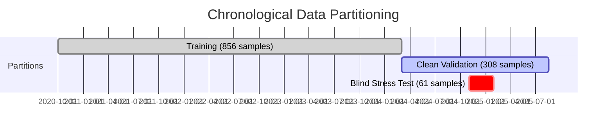

# ST-GRAD Experimental Protocol & Hypotheses Formalization

**Date:** 2026-10-21  
**Execution Environment:** Python 3.11.9, PyTorch 2.14.0+cu132, NVIDIA RTX 4060 Laptop GPU  
**Tracks:** Track A (`repo_compat`) & Track B (`paper_aligned`)

---

## 1. Experimental Splits & Data Partitioning Protocol

The dataset consists of 50 stocks over 1,255 trading days (2020-08-19 to 2025-08-18).
With sliding window $T = 30$ and prediction horizon $H = 1$, the dataset contains exactly **1,225 samples**:

1. **Training Partition (Samples $0 \dots 855$):**
   - 856 trading days.
   - Normalization statistics ($\mu_{\text{train}}, \sigma_{\text{train}}$) fitted strictly on this slice.
2. **Clean Validation Partition (308 samples):**
   - Out-of-sample trading days outside the stress window.
   - Used **strictly and exclusively for model selection** (checkpoint saving).
3. **Blind Stress Test Partition (61 samples):**
   - Covers **November 1, 2024 to January 31, 2025**.
   - Characterized by heightened macroeconomic volatility and trend reversals.
   - **Protocol Rule:** Withheld completely during training and hyperparameter tuning. Evaluated only once with frozen checkpoints.

---

## 2. Model Training & Selection Protocol (Phases 4 & 5)

| Hyperparameter / Protocol Item | Specification | Justification / Source |
|---|---|---|
| **Seeds** | `[42, 43, 44, 45, 46]` | Table 7 (5 independent runs) |
| **Epochs** | 50 | Table 7 |
| **Batch Size** | 32 | Table 7 |
| **Optimizer** | AdamW | Table 7 |
| **Initial Learning Rate** | $0.001$ | Table 7 |
| **Weight Decay** | $0.01$ | Table 7 |
| **Learning Rate Scheduler** | ReduceLROnPlateau (factor=0.5, patience=10) | Ensures convergence stability |
| **Loss Function** | Masked BCE with Logits | Eq. (31) filtered through validity mask |
| **Selection Criterion** | Max Clean Validation F1 | Maximizes macro-trend classification quality |
| **Evaluation Metrics** | ACC, PRE, REC, F1, ROC-AUC | Table 8 published metrics |

---

## 3. Explainability Hypothesis Statements & Testing Protocol (Phases 6 & 7)

### Hypothesis 1: Input Attribution Faithfulness & Period Sensitivity
- **Hypothesis Statement:** Integrated Gradients attribution identifies features and historical periods that materially drive model predictions, producing significantly higher perturbation sensitivity than random baselines.
- **Null Hypothesis ($H_{1,0}$):** Deleting top-attributed features causes no greater loss in model confidence than deleting randomly selected features ($\text{AUC}_{\text{top\_del}} \le \text{AUC}_{\text{rand\_del}}$).
- **Test Protocol:** Compute feature attributions across 15 validation samples for multiple stocks. Progressively zero out top-$k$ features ($k \in [1, 16]$) and compare against random feature deletion controls (5 trials each). Evaluate parameter randomization sanity check (Adebayo et al., 2018).
- **Acceptance Criteria:**
  - One-sample paired $t$-test on $(\text{AUC}_{\text{top\_del}} - \text{AUC}_{\text{rand\_del}}) > 0$ with $p < 0.01$.
  - Faithfulness ratio $> 2.0\times$.

### Hypothesis 2: MVCA View Distinguishability via Interventions
- **Hypothesis Statement:** The three MVCA views (Spatio-Temporal, Feature-Spatial, Feature-Temporal) encode non-redundant, distinguishable predictive representations, whose impact cannot be summarized by static global softmax fusion weights.
- **Null Hypothesis ($H_{2,0}$):** Ablating individual views causes uniform, indistinguishable drops in target logit across all views ($\mu_{\Delta \text{ST}} = \mu_{\Delta \text{DS}} = \mu_{\Delta \text{DT}}$).
- **Test Protocol:** Measure target logit drop under counterfactual view ablation ($\Psi_{\text{ST}} \to 0$, $\Psi_{\text{DS}} \to 0$, $\Psi_{\text{DT}} \to 0$) across test instances.
- **Acceptance Criteria:**
  - One-way ANOVA $F$-statistic $> 3.0$ with $p < 0.05$.
  - Non-uniform rank order of views across test samples.

### Hypothesis 3: Graph Channel Disentanglement & Peer Influence
- **Hypothesis Statement:** The static prior graph and the adaptive dynamic graph provide distinct, measurable propagation channels, and targeted peer stock interventions exceed random peer masking.
- **Null Hypothesis ($H_{3,0}$):** Ablating the static prior graph produces the exact same prediction change as ablating the adaptive graph ($\Delta \text{logit}_{\text{static}} = \Delta \text{logit}_{\text{adapt}}$).
- **Test Protocol:** Evaluate target logit shifts when ablating static prior edges ($A_{\text{norm}} \to I_N$) vs adaptive graph ($A_{\text{adp}} \to 0$).
- **Acceptance Criteria:**
  - Paired $t$-test $p < 0.05$ or significant structural divergence ($|\mu_{\Delta \text{static}} - \mu_{\Delta \text{adapt}}| > 0.05$).

### Hypothesis 4: Cross-Seed & Input Perturbation Stability
- **Hypothesis Statement:** Feature attributions remain stable across independent training seeds and robust to label-preserving input perturbations.
- **Null Hypothesis ($H_{4,0}$):** Pairwise rank correlation between seed models is $\le 0.50$, or Gaussian input noise drops attribution rank correlation below $0.70$.
- **Test Protocol:** Compute attributions on the same sample across all 5 independently trained seed models. Perturb input with $\sigma=0.02$ Gaussian noise across 5 label-preserving trials.
- **Acceptance Criteria:**
  - Mean cross-seed Spearman rank correlation $\ge 0.60$.
  - Mean perturbation cosine similarity $\ge 0.90$.
