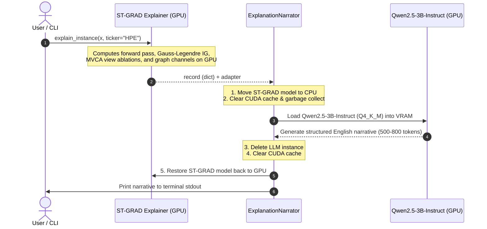

# Local LLM Narrative Reasoning Layer Guide

**Module:** [`src/explainability/narrator.py`](../src/explainability/narrator.py)  
**CLI Interface:** `python src/cli.py explain --ticker <TICKER> --narrative`  
**Primary Engine:** Qwen2.5-3B-Instruct (Q4_K_M GGUF, ~2.1 GB) via `llama-cpp-python`  
**Hardware Strategy:** Sequential GPU Swap (ST-GRAD $\leftrightarrow$ LLM)  

---

## 1. Overview & Motivation

While the ST-GRAD explainability suite computes mathematically rigorous diagnostics—Gauss-Legendre Integrated Gradients attributions, counterfactual MVCA view ablations, and decoupled graph diffusion channel impacts—these metrics can be difficult for quantitative analysts and portfolio managers to quickly synthesize.

The **Narrator Reasoning Layer** bridges this gap by reading the standardized JSON case record and synthesizing a **structured, 500–800 word analyst report in plain English** without human-in-the-loop summarization.

---

## 2. Hardware Architecture & Sequential GPU Swap

Because consumer workstations often have bounded VRAM (e.g., an NVIDIA GeForce RTX 2050 with 3.7 GB VRAM total), running both the ST-GRAD spatial-temporal graph neural network and a 3-billion-parameter language model simultaneously would cause out-of-memory errors (`CUDA OOM`).

To prevent VRAM contention, `ExplanationNarrator` implements an automated **Sequential GPU Memory Swap**:



### Resource Profile:
- **ST-GRAD PyTorch Footprint:** ~0.48 GB VRAM.
- **Qwen2.5-3B-Instruct (Q4_K_M) Footprint:** ~2.15 GB VRAM.
- **Available Hardware:** 3.7 GB total VRAM on RTX 2050 $\implies$ **Fits with >1.5 GB safety margin**.

---

## 3. Strict Non-Causal Grounding Directives

Financial machine learning explanations frequently suffer from model hallucination: language models often invent external economic stories (e.g., "HPE stock rose because quarterly cloud earnings beat Wall Street estimates") that the neural network never saw.

The narrator enforces **strict system prompt grounding**:
1. **Factual Grounding:** The model is prohibited from citing external news, earnings releases, macroeconomic events, or corporate fundamentals. It is only permitted to reference the indicators and ablation numbers in the diagnostic record.
2. **Non-Causal Language:** The model must use model-dependence vocabulary:
   - *Allowed:* `"The model relied on...", "The model output changed when...", "Ablation revealed strong sensitivity to..."`
   - *Forbidden:* `"Stock A caused stock B to rise", "Earnings growth drove the stock"`
3. **Signal Resolution:** When technical indicators conflict (e.g., bullish `BB_Position` vs bearish `Close_MA_Ratio`), the model must explicitly describe how the neural network weighted their opposing magnitudes.

---

## 4. Required Output Structure

The narrator organizes its analysis into five structured markdown sections:

1. **`## Prediction Summary`**: Target ticker, date, direction (`UP`/`DOWN`), probability, logit, confidence, and comparison with ground truth if available.
2. **`## Key Feature Drivers`**: Analysis of top-5 Integrated Gradients technical features, resolving bullish drivers against bearish headwinds.
3. **`## Temporal Focus`**: Lookback dynamics, recency ratio, and whether the model focused on immediate trailing trading days ($t-1$ to $t-4$) or longer-term historical trends.
4. **`## Peer & Spatial Influence`**: Target stock's intrinsic attribution share vs cross-stock diffusion, static macro-cluster prior ablation vs adaptive dynamic graph ablation, and top influential peer tickers.
5. **`## Reliability & Convergence Diagnostics`**: Completeness axiom verification (Gauss-Legendre convergence delta $<0.2\%$), quadrature steps used, and stability status.

---

## 5. Setup & Usage

### 5.1 Dependencies
Install the required packages in your virtual environment:
```bash
pip install llama-cpp-python huggingface_hub
```

### 5.2 Command-Line Execution
Run an explanation with natural language reasoning:

```bash
# Basic run: auto-downloads Qwen2.5-3B-Instruct on first use
python src/cli.py explain --ticker HPE --split val_clean --index 0 --narrative

# Specify custom GGUF model path
python src/cli.py explain --ticker NVDA --split stress --index 5 --narrative --model-path models/llm/qwen2.5-3b-instruct-q4_k_m.gguf

# Specify custom cache directory
python src/cli.py explain --ticker MSFT --split val_clean --index 10 --narrative --cache-dir /data/models/llm
```

### 5.3 Automated Weight Management
On first execution with `--narrative`, `ExplanationNarrator` automatically downloads `qwen2.5-3b-instruct-q4_k_m.gguf` (~2.1 GB) from the official `Qwen/Qwen2.5-3B-Instruct-GGUF` Hugging Face repository into `models/llm/`. Subsequent executions detect the cached file and load instantly.
